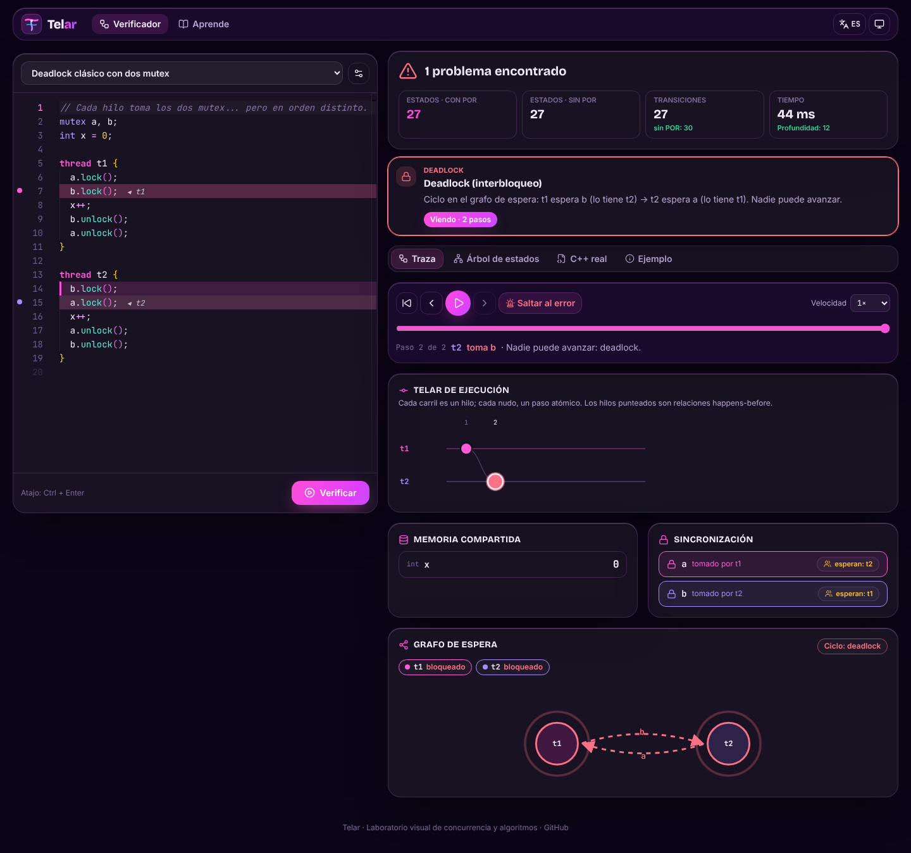
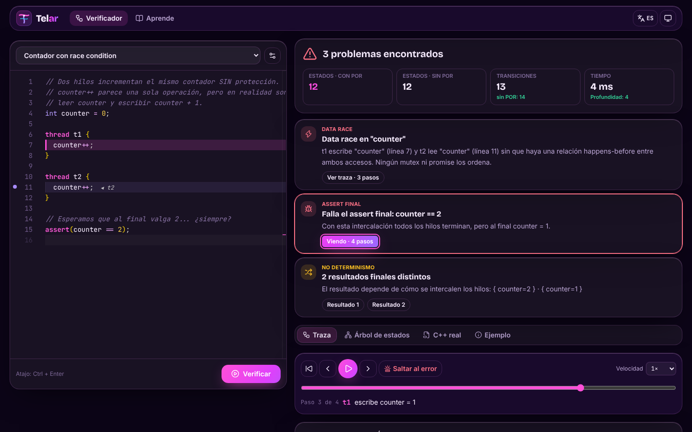
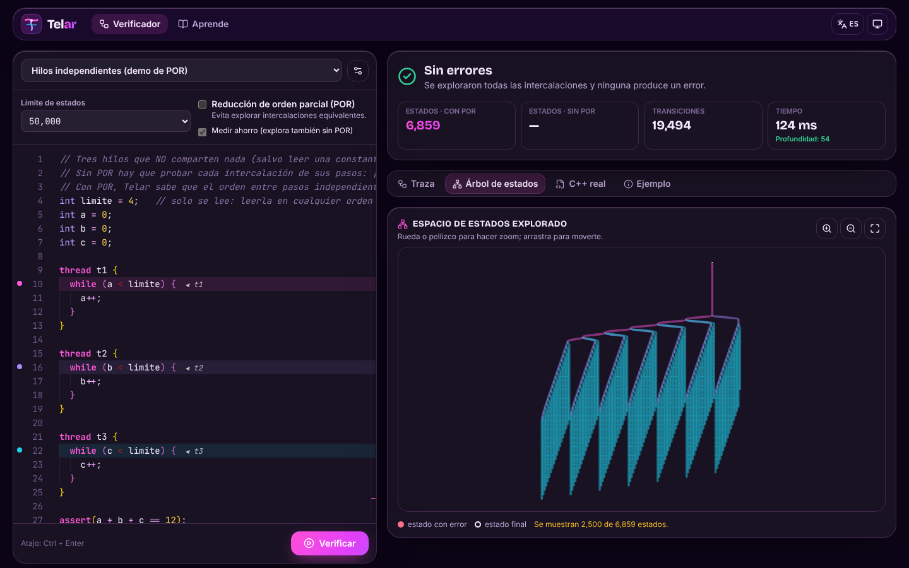
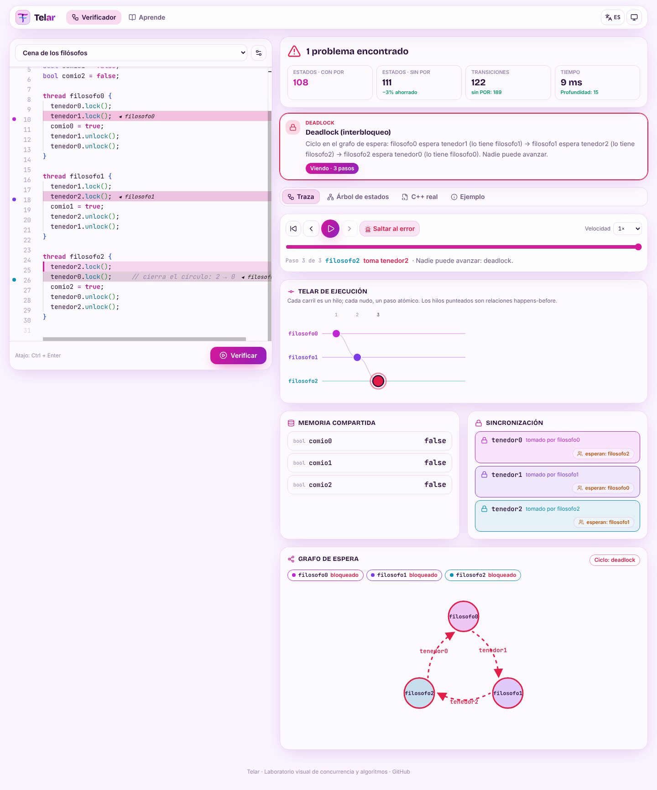
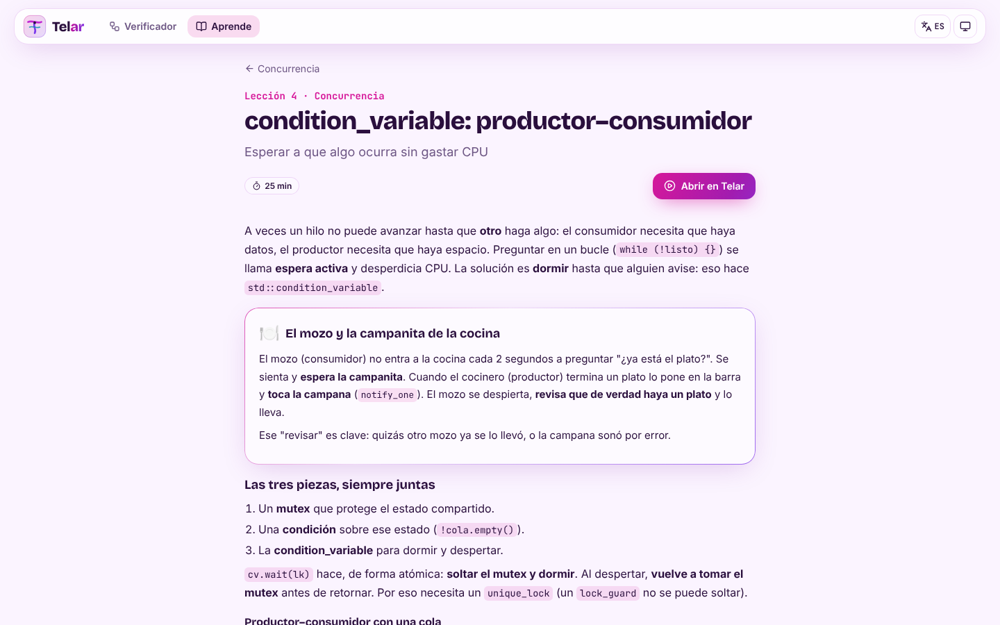
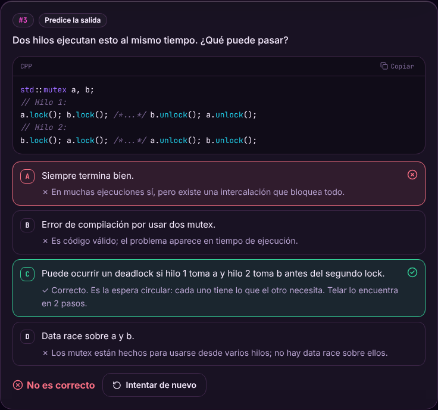
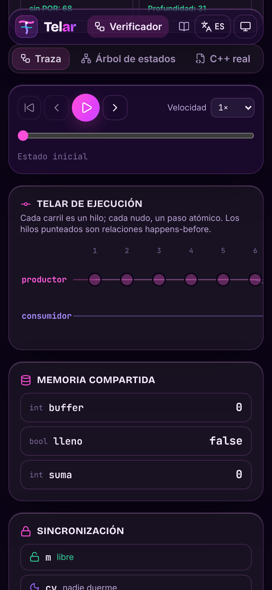
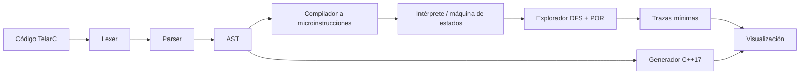

<div align="center">


# Telar

**Laboratorio visual de concurrencia y algoritmos** · _Visual lab for concurrency and algorithms_

Explora **todas** las intercalaciones de un programa concurrente, encuentra data races y deadlocks,
y reprodúcelos paso a paso como en un telar.

[**▶ Demo en vivo**](https://indira-yabar-s.github.io/progra3-estudio/) ·
[Arquitectura](docs/arquitectura.md) ·
[Decisiones](docs/decisiones.md) ·
[English](#english)

[](https://github.com/indira-yabar-s/progra3-estudio/actions/workflows/ci.yml)




</div>

---

## ¿Qué es?

Los bugs de concurrencia aparecen en **una** intercalación entre millones: correr el programa
muchas veces no los encuentra. Telar es un **model checker** educativo que corre en el navegador:

1. Escribes un programa en **TelarC**, un subconjunto legible de C++ con `thread`, `mutex`,
   `lock_guard`, `unique_lock`, `scoped_lock`, `condition_variable` y `promise/future`.
2. Telar lo compila con un **lexer y parser propios** y explora **todo el espacio de estados**
   (DFS con hashing y **reducción de orden parcial**) dentro de un **Web Worker**.
3. Detecta **data races** (happens-before con **relojes vectoriales**), **deadlocks** (ciclo en el
   **grafo de espera**), **asserts que fallan** y **resultados finales distintos**.
4. Para cada problema te da la **traza contraejemplo más corta** y la reproduce: carriles por hilo,
   memoria compartida, mutex, grafo de espera animado, línea de cada hilo en el editor y el árbol de
   estados explorado. También muestra el **C++17 real** equivalente.

Además incluye **Aprende concurrencia**: el temario de Programación III (UTEC) con lecciones,
analogías, código C++17 comentado línea por línea, preguntas tipo examen con explicación de cada
opción, hojas de repaso imprimibles y un simulacro con nota sobre 20.

|                                                                                                                                                  |                                                                                                                     |
| ------------------------------------------------------------------------------------------------------------------------------------------------ | ------------------------------------------------------------------------------------------------------------------- |
|  |          |
| **Race condition** en `counter++`: t1 y t2 leen 0 antes de escribir.                                                                             | **Árbol de estados** explorado (zoom y paneo; errores en rojo).                                                     |
|           |  |
| **Cena de los filósofos**: ciclo de 3 en el grafo de espera (modo claro).                                                                        | **Lecciones** con analogías y botón _Abrir en Telar_.                                                               |

<p align="center">
  
  
</p>

## Características

- 🧵 **TelarC**: globales `int`/`bool`, locales, aritmética, `if`/`while`, `assert`, hilos,
  `mutex` (`lock`/`unlock`), `lock_guard`/`unique_lock`/`scoped_lock` (RAII por bloque),
  `condition_variable` (`wait`/`notify_one`/`notify_all`) y `promise`/`future`.
- 🧭 **Errores en español con línea y columna**, subrayados en Monaco mientras escribes.
- 🔍 **Explorador**: DFS iterativo, estados repetidos por hash, límite configurable, **POR**
  (sleep sets + ample sets con análisis _must-lockset_) y medición real del ahorro
  (ej.: 6 859 → 55 estados).
- 🐞 **Detecta**: data races (relojes vectoriales), deadlocks y bloqueos permanentes, asserts,
  errores de ejecución (`unlock` sin tener el mutex, `set_value` doble, división entre cero…) y
  no determinismo.
- 🎞️ **Reproductor de trazas**: anterior / siguiente / reproducir / velocidad / saltar al error,
  con teclado.
- 🧶 **Visualizaciones**: telar por hilos con aristas happens-before, memoria (lecturas/escrituras),
  mutex, grafo de espera animado, árbol de estados con zoom/paneo y C++17 real.
- 📚 **13 ejemplos** con explicación y “qué deberías observar”, incluido un **reto** que Telar da
  por superado cuando ya no hay errores.
- 🎓 **Aprende concurrencia**: 5 lecciones, 25 preguntas + simulacro de 15 (nota /20), hojas de
  repaso imprimibles y repaso de preguntas falladas (progreso en `localStorage`).
- ✨ **Diseño**: glassmorphism magenta/fucsia/violeta, modo claro/oscuro, responsive,
  micro-animaciones que respetan `prefers-reduced-motion`, interfaz en español e inglés.
- 📴 **PWA instalable** que funciona **offline** (incluido Monaco y el verificador).

## Cómo correrlo

Requisitos: Node.js 20+ (recomendado 22).

```bash
npm install
```

```bash
npm run dev
```

Abre <http://localhost:5173>. Otros comandos:

| Comando                           | Qué hace                                                   |
| --------------------------------- | ---------------------------------------------------------- |
| `npm run build`                   | Typecheck + build de producción en `dist/`                 |
| `npm run preview`                 | Sirve el build en <http://localhost:4173/progra3-estudio/> |
| `npm test`                        | Tests unitarios (Vitest)                                   |
| `npm run test:coverage`           | Tests + cobertura del núcleo (umbral 80%)                  |
| `npm run test:e2e`                | Tests end-to-end con Playwright (escritorio y celular)     |
| `npm run lint` / `npm run format` | ESLint / Prettier                                          |

## Stack

**React 19** · **TypeScript (strict)** · **Vite** · **Tailwind CSS v4** · **Monaco Editor** ·
**Zustand** · **Vitest** · **Playwright** · **ESLint + Prettier** · **vite-plugin-pwa (Workbox)** ·
**GitHub Actions + GitHub Pages**. Sin librerías de parsing ni de grafos: el lexer, el parser, el
explorador y las visualizaciones SVG están hechos a mano.

## Arquitectura



```text
src/
├─ core/telarc/       # lenguaje + verificador (TypeScript puro, sin UI)
│  ├─ lexer.ts parser.ts compiler.ts machine.ts
│  ├─ explorer.ts happensBefore.ts waitGraph.ts trace.ts verify.ts
│  ├─ cppgen.ts examples.ts
│  └─ __tests__/
├─ workers/           # Web Worker del verificador
├─ modules/           # módulos del laboratorio (registry.ts)
│  ├─ verifier/       # editor, telar, reproductor, paneles, árbol
│  ├─ learn/          # lecciones, preguntas, simulacro, repaso, progreso
│  └─ home/
├─ content/           # contenido del curso en JSON (genérico por tema)
├─ components/ i18n/ stores/ styles/ lib/
e2e/                  # Playwright
docs/                 # arquitectura.md, decisiones.md, capturas
```

Detalle y teoría (intercalaciones, happens-before, relojes vectoriales, POR) en
[`docs/arquitectura.md`](docs/arquitectura.md). Decisiones de diseño en
[`docs/decisiones.md`](docs/decisiones.md).

## Hoja de ruta

- **Fase 1** ✅ Verificador visual de concurrencia + módulo de estudio de concurrencia.
- **Fase 2** Visualizadores de estructuras de datos (stack, queue, heap, BST, hash) y grafos
  (BFS, DFS, Prim, Kruskal, Dijkstra, Floyd).
- **Fase 3** Modo examen de todo el curso, patrones de diseño y landing page.

## Despliegue

Cada push a `main` corre el pipeline completo y publica `dist/` en GitHub Pages. La primera vez hay
que activar Pages en **Settings → Pages → Build and deployment → Source: GitHub Actions** y
volver a ejecutar el workflow (_Actions → CI → Run workflow_).

---

<a id="english"></a>

## English

**Telar** (Spanish for _loom_) is an in-browser, educational **model checker for concurrent
programs**. You write a small C++-like program (_TelarC_: threads, `mutex`, `lock_guard`,
`unique_lock`, `scoped_lock`, `condition_variable`, `promise/future`) and Telar:

- parses it with a **hand-written lexer and recursive-descent parser** (errors with line/column,
  highlighted in Monaco),
- lowers it to atomic micro-instructions and runs it as a **state machine**,
- explores **every interleaving** with an iterative **DFS**, state hashing, a configurable state
  limit and **partial order reduction** (sleep sets + static ample sets backed by a _must-lockset_
  dataflow analysis), measuring the real savings (e.g. 6,859 → 55 states),
- detects **data races** (happens-before with **vector clocks**, like ThreadSanitizer),
  **deadlocks** (cycle in the **wait-for graph**), failing **asserts**, runtime errors and
  **nondeterministic results**,
- produces the **shortest counterexample trace** (BFS over the explored graph) and replays it with
  a per-thread **loom timeline**, shared memory, mutex state, an animated wait-for graph, per-thread
  line highlighting in the editor, a zoomable **state tree** and the equivalent **real C++17**
  (verified to compile with `g++ -Wall -Werror` in the test suite),
- all inside a **Web Worker** with progress and cancel.

It also ships a **study module** for the Programming III course at UTEC (Peru): 5 lessons with
analogies and line-by-line commented C++17, 25 exam-style questions with per-option explanations,
printable review sheets and a 15-question mock exam graded out of 20, with progress stored in
`localStorage`. The UI is available in **Spanish and English**; course content is in Spanish.

**Stack:** React 19, TypeScript (strict), Vite, Tailwind CSS v4, Monaco Editor, Zustand, Vitest,
Playwright, ESLint + Prettier, vite-plugin-pwa, GitHub Actions + Pages. Installable **PWA** that
works **offline**.

**Run it:** `npm install` then `npm run dev` (Node 20+). Tests: `npm test`, `npm run
test:coverage`, `npm run test:e2e`.

**Read more:** [architecture & theory](docs/arquitectura.md) · [design decisions](docs/decisiones.md)
(both in Spanish).
