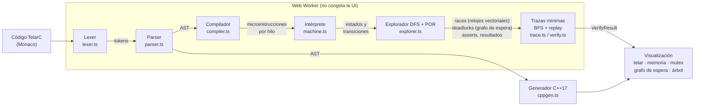

# Arquitectura de Telar

Este documento explica **cómo está construido Telar** y **la teoría detrás del verificador**, en
español sencillo, para que puedas explicarlo en una entrevista técnica.

---

## 1. Vista general

Telar es una SPA (React + TypeScript) sin backend. Todo el análisis ocurre en el navegador. El
núcleo (`src/core/telarc`) es **TypeScript puro**: no importa React ni nada del DOM, así que se
puede testear con Vitest en Node y ejecutar dentro de un Web Worker.



### Capas y carpetas

| Carpeta                       | Responsabilidad                                                                                 |
| ----------------------------- | ----------------------------------------------------------------------------------------------- |
| `src/core/telarc/`            | Lenguaje TelarC + verificador. Sin dependencias de UI. 97% de cobertura.                        |
| `src/workers/`                | Web Worker que ejecuta `verify()` y envía progreso.                                             |
| `src/modules/<módulo>/`       | Cada módulo del laboratorio (verificador, aprende…). Se registran en `src/modules/registry.ts`. |
| `src/content/<curso>/<tema>/` | Contenido del curso en JSON (lecciones, preguntas, simulacro).                                  |
| `src/components/`             | Componentes compartidos (tarjetas de vidrio, pestañas, markdown, código).                       |
| `src/i18n/`                   | Diccionarios `es`/`en` tipados (TypeScript obliga a traducir todas las claves).                 |
| `src/stores/`                 | Estado global con Zustand (tema, idioma).                                                       |

### Arquitectura modular (fases 2 y 3)

Cada módulo es una entrada en `MODULES` (`src/modules/registry.ts`) con su ruta, ícono, fase y un
componente cargado con `lazy()`. La navegación, la página de inicio y el router se generan a partir
de esa lista. Agregar "Grafos" en la fase 2 es: crear `src/modules/graphs/`, registrar el módulo y
listo; el código de Monaco o del verificador no se descarga si no se visita su ruta.

El contenido del curso sigue la misma idea: `src/modules/learn/content/schema.ts` define el formato
genérico (lección, pregunta, simulacro, hoja de repaso) y el cargador descubre los JSON con
`import.meta.glob`. Un tema nuevo (Big O, patrones…) es solo agregar archivos.

---

## 2. El lenguaje TelarC

TelarC es un subconjunto de C++ fácil de leer:

```cpp
int counter = 0;        // globales int/bool (memoria compartida)
mutex m;                // también: condition_variable, promise<int>, future<int>

thread t1 {             // cada bloque thread es un hilo
  lock_guard<mutex> g(m);
  counter++;
}
thread t2 { m.lock(); counter++; m.unlock(); }

assert(counter == 2);   // assert final: se evalúa cuando todos los hilos terminan
```

### Lexer (`lexer.ts`)

Recorre el texto carácter por carácter y produce **tokens** (palabras clave, identificadores,
números, símbolos). Lleva la cuenta de **línea y columna** de cada token, para que todo error
posterior pueda señalar el lugar exacto. Toma siempre el operador más largo posible (`<=` antes que
`<`). Ignora comentarios y `#include` para que el código se parezca a C++ real.

### Parser (`parser.ts`)

Es un **parser descendente recursivo** escrito a mano: una función por regla de la gramática
(`parseStmt`, `parseBlock`, `parseExpr`…). Las expresiones usan **precedence climbing** con la
misma precedencia que C++ (`*` antes que `+`, `&&` antes que `||`). Produce un **AST** (árbol de
sintaxis abstracta). Los errores son `TelarCError` con mensaje en español e inglés y su posición;
Monaco los muestra subrayados en rojo.

### Compilador (`compiler.ts`)

Recorre el AST, comprueba **tipos y nombres** (variables no declaradas, `wait` con `lock_guard`,
`f.get()` mal usado…) y lo **"baja" a microinstrucciones**. La decisión clave:

> Cada **lectura** o **escritura** de memoria compartida es una instrucción separada.

Así `counter++` se convierte en:

```text
LOAD  counter → r0      ← paso atómico 1
STORE counter = r0 + 1  ← paso atómico 2
```

Entre esos dos pasos otro hilo puede ejecutarse: ahí vive la race condition. Las variables
**locales** no generan pasos visibles (otro hilo no puede verlas), así que se ejecutan "de corrido"
junto al paso anterior. Eso reduce muchísimo el espacio de estados sin perder ningún bug.

`lock_guard`/`unique_lock`/`scoped_lock` se compilan como RAII: un `lock` al declararlos y un
`release` automático al final del bloque. `cv.wait(lk)` se compila como dos pasos: _soltar el
mutex y dormir_ (atómico) y _volver a tomar el mutex_ al despertar.

### Intérprete (`machine.ts`)

Es una **máquina de estados**. Un estado es una foto completa:

- valores de las globales,
- por cada hilo: contador de programa, locales, registros temporales y si está corriendo, dormido o terminado,
- dueño de cada mutex, hilos dormidos en cada `condition_variable`, valor de cada `promise`.

Una **transición** es "el hilo _T_ ejecuta su siguiente paso atómico". Un hilo está **habilitado**
si puede avanzar (por ejemplo, `lock(m)` solo está habilitado si `m` está libre). `notify_one` con
varios hilos dormidos genera **varias transiciones** (una por cada hilo que podría despertar).

---

## 3. Teoría del explorador (para la entrevista)

### 3.1 Intercalaciones

Si dos hilos tienen los pasos `a1 a2` y `b1 b2`, el sistema operativo puede ejecutarlos en
cualquier orden que respete el orden dentro de cada hilo:

```text
a1 a2 b1 b2    a1 b1 a2 b2    a1 b1 b2 a2
b1 a1 a2 b2    b1 a1 b2 a2    b1 b2 a1 a2
```

Cada orden es una **intercalación** (_interleaving_). Con _n_ hilos de _k_ pasos hay
`(n·k)! / (k!)ⁿ` intercalaciones: crece explosivamente. Un bug de concurrencia es una
intercalación "mala" que en la vida real quizás aparece una vez en un millón de ejecuciones. Por eso
**probar el programa muchas veces no sirve**: hay que **explorarlas todas**.

### 3.2 Búsqueda en el espacio de estados (DFS + hashing)

En vez de enumerar secuencias, Telar recorre **estados**: desde el estado inicial prueba cada
transición habilitada, llega a un estado nuevo y repite (búsqueda en profundidad, **DFS**, con pila
explícita para no desbordar la pila de JavaScript).

Muchas intercalaciones distintas llegan al **mismo estado** (por ejemplo, `a1 b1` y `b1 a1` si son
independientes). Cada estado se resume en una **clave canónica** (`hash`); si ya la visitamos, no
volvemos a explorar desde ahí. Eso convierte un árbol exponencial en un grafo mucho más pequeño, y
además permite terminar en programas con bucles de espera activa (los estados se repiten).

Hay un **límite configurable de estados** (y de profundidad). Si se alcanza, Telar lo dice: la
exploración fue _incompleta_ y podría haber errores sin encontrar.

### 3.3 Reducción de orden parcial (POR)

Dos pasos son **independientes** si ejecutarlos en cualquier orden da el mismo resultado y ninguno
habilita o deshabilita al otro. En Telar: no tocan el mismo objeto de sincronización y no acceden a
la misma variable con al menos una escritura (dos lecturas sí son independientes).

Las intercalaciones que solo difieren en el orden de pasos independientes son **equivalentes**
(forman una _traza de Mazurkiewicz_): basta explorar **una**. Telar combina dos técnicas:

1. **Sleep sets** (conjuntos dormidos): si desde un estado ya exploramos el paso `a` y ahora
   exploramos `b` (independiente de `a`), en la rama de `b` no hace falta volver a probar `a`:
   `a·b` y `b·a` llegan al mismo lugar. `a` "duerme" en esa rama hasta que se ejecute algo
   dependiente de él. Con caché de estados, si llegamos a un estado ya visitado con un sleep set
   _más chico_, re-exploramos solo lo que faltaba.
2. **Ample sets estáticos**: si un hilo va a ejecutar un paso **seguro** (independiente de todo lo
   que cualquier otro hilo pueda hacer después), basta con explorar solo ese paso. Un paso es seguro
   si toca variables que nadie más usa, si lee una variable que nadie más escribe, o si accede a una
   variable que **siempre** se usa bajo el mismo mutex que el hilo ya tiene tomado. Esto último lo
   sabemos con un **análisis de flujo de datos "must-lockset"** sobre las microinstrucciones
   (qué mutex están tomados con seguridad en cada instrucción). Para no "posponer para siempre" a
   otros hilos se aplica la **condición de ciclo** (C3): no se usa el ample set si el estado
   siguiente ya está en la pila del DFS.

Telar **mide el ahorro**: vuelve a explorar sin POR y muestra ambos números. En el ejemplo
"Hilos independientes" pasa de **6 859** estados a **55**. Un test comprueba, para todos los
ejemplos, que con y sin POR se encuentran **los mismos tipos de error y los mismos resultados
finales**.

### 3.4 Happens-before y relojes vectoriales (data races)

Una **data race** son dos accesos a la misma variable, de hilos distintos, al menos uno de
escritura, **sin una relación _happens-before_** entre ellos.

_Happens-before_ (HB) es "A ocurrió-antes que B y B puede ver lo que hizo A". Se forma por:

- el orden del programa dentro de un hilo,
- `unlock(m)` → el siguiente `lock(m)` de otro hilo,
- `set_value` de una promise → `get` del future,
- y la transitividad (si A→B y B→C, entonces A→C).

Para saber si dos eventos están ordenados por HB se usan **relojes vectoriales**: cada hilo _t_
lleva un vector `C[t]`, donde `C[t][u]` dice "cuánto de la historia del hilo _u_ conoce _t_".

- Al hacer `unlock(m)` el hilo **publica** su reloj en el mutex (`L[m] = C[t]`) y avanza su
  propio contador.
- Al hacer `lock(m)` el hilo **combina** (máximo componente a componente) su reloj con `L[m]`.
- Cada acceso guarda su _epoch_: `(hilo u, valor de C[u][u] en ese momento)`.
- Un acceso anterior `(u, c)` ocurre-antes del hilo actual _t_ si `c ≤ C[t][u]`. Si **no**, y uno
  de los dos escribe: **race**.

Ventaja enorme: la race se detecta aunque en _esta_ ejecución los accesos no hayan coincidido en el
tiempo. En el contador sin mutex, basta la primera intercalación (t1 completo y luego t2) para
saber que no hay HB entre `t1 escribe` y `t2 lee`. Es la idea de los detectores reales como
**ThreadSanitizer** (algoritmo FastTrack/DJIT+).

### 3.5 Deadlocks y grafo de espera

Un estado es **terminal** si ningún hilo está habilitado. Si además algún hilo no terminó, es un
**bloqueo**. Telar construye el **grafo de espera**: arista `A → B` si A espera un mutex que tiene
B. Un **ciclo** (encontrado con DFS de tres colores) es un **deadlock** clásico (espera circular de
Coffman). Si no hay ciclo pero hay hilos dormidos en una `condition_variable` o esperando un
`future` sin valor, es un **bloqueo permanente** (por ejemplo, una notificación perdida).

### 3.6 Asserts y resultados finales

- Un `assert` dentro de un hilo que falla deja el estado en error.
- Los `assert` del final se evalúan en cada estado donde **todos** los hilos terminaron.
- Telar junta los valores finales de las globales de todos esos estados: si hay **más de uno
  distinto**, el programa es **no determinista** y se muestra cada resultado con su traza.

### 3.7 Traza contraejemplo más corta

El DFS encuentra errores, pero sus caminos no son los más cortos. Por eso el explorador guarda el
**grafo de estados explorado** y, al final, hace un **BFS** desde el estado inicial: BFS da el
camino con menos pasos hasta cada estado. La traza se **reproduce** (`replay`) paso a paso para
construir las fotos que ve el reproductor. Para las races se comprueba que la traza corta
reproduce la misma race (porque HB depende de la historia); si no, se usa la del DFS.

### 3.8 Web Worker

`verify()` corre en un **Web Worker**: un hilo de JavaScript separado. La interfaz sigue fluida
aunque se exploren cientos de miles de estados; el worker envía mensajes de progreso (con
_throttling_) y **cancelar** es simplemente `worker.terminate()`.

---

## 4. Visualización

| Vista                  | Qué muestra                                                                                              | De dónde sale                       |
| ---------------------- | -------------------------------------------------------------------------------------------------------- | ----------------------------------- |
| **Telar** (timeline)   | Un carril por hilo, un nudo por paso; la "trama" muestra los cambios de hilo y las aristas HB punteadas. | `Trace.steps`, `syncEdges`          |
| **Memoria compartida** | Valor de cada global; resalta lectura (cian) y escritura (magenta), en rojo si hay race.                 | `Snapshot.globals`, evento del paso |
| **Sincronización**     | Cada mutex: libre / tomado por / quién espera. CVs y promises.                                           | `Snapshot.owner`, `waitGraph`       |
| **Grafo de espera**    | Hilos en círculo; flechas animadas en rojo si hay ciclo.                                                 | `buildWaitGraph()`                  |
| **Editor**             | Línea de cada hilo (color del hilo), paso actual y líneas del error.                                     | `Snapshot.threads[].loc`            |
| **Árbol de estados**   | Árbol DFS del espacio explorado, zoom/paneo, estados con error en rojo.                                  | `tree.nodes` + layout propio        |
| **C++ real**           | Traducción a C++17 que compila con g++ (un test lo verifica).                                            | `cppgen.ts`                         |

---

## 5. Calidad

- **Vitest**: tests del lexer, parser, compilador, intérprete, relojes vectoriales, grafo de espera,
  explorador (casos que **deben** tener race/deadlock y casos que **no**), POR (equivalencia con y
  sin POR), generador C++ (compila con `g++ -Wall -Werror`) y validación de todo el contenido del
  curso. Cobertura del núcleo ≈ 97% (mínimo exigido en CI: 80%).
- **Playwright**: abrir el deadlock → verificar → aparece la traza; programa correcto; errores de
  compilación; lecciones y simulacro. En escritorio y en celular.
- **CI (GitHub Actions)**: lint + formato + tipos + tests con cobertura + build + e2e en cada push;
  deploy a GitHub Pages desde `main`.
